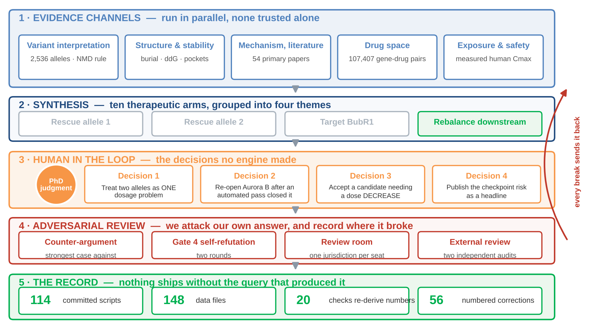

# MVA Hackathon 2026 — Track 2 (Drug Repurposing)

Submission for *Rare Disease, Real Kid: The MVA Hackathon 2026*, organised by Sage
Bionetworks with the MVA Society, Hugging Face and BEACON.
Maaz Asher Khurram &mdash; mk7790@nyu.edu. Submitting username: **mk7790**.

**These are hypotheses for follow-up, not evidence that any medicine works.**
Nothing here is clinical advice. No patient data is redistributed in this
repository: what is committed is the *query*, never the data it read.

---

## The problem

Proband `WGS_EX2312012` carries two BUB1B alleles: **p.Leu737Ter** (c.2210T>G) and
**p.Asn1002Lys** (c.3006T>G). BubR1 is a dosage protein at the kinetochore. Too little
of it and chromosomes missegregate, which is what mosaic variegated aneuploidy is.

The awkward fact about this target: **every cell-cycle drug in clinical use was built to
break the cell cycle.** Oncology and transplant medicine paid for all of it. Nobody ever
needed a drug that makes segregation work *better*, so the chemical matter points the
wrong way.

## The four questions

We made the work answer these in order, and would not let ourselves pick a compound
until each had closed.

| | Question | Answered in |
|---|---|---|
| **Q1** | What do these two alleles actually leave behind — not "pathogenic", but how much protein, with which domains? | `BUB1B-MUTATION-ATLAS.md`, `NMD-STRATIFIED-BUB1B.md`, `N1002-STRUCTURAL-COUPLING.md` |
| **Q2** | Is the deficit reversible at all? If restoring BubR1 does nothing, no drug can work. | `MECHANISM.md`, `MVA-THERAPEUTIC-EVIDENCE-BASE.md` |
| **Q3** | Is there *any* drug that raises BubR1, or its phosphatase? | `APPROACHES-ALL.md`, `GERO-DRUGGABILITY-MINING.md`, `TRIED-AND-FAILED.md` |
| **Q4** | If not, what else sits on the same node — and at what dose? | `THE-PICK.md`, `EXPOSURE-DOSSIER-KOSMOS-LEADS.md`, `ASSAY-DESIGN.md` |

## The mechanism, in one paragraph

Aurora B phosphorylates **Hec1**, the kinetochore protein that grips the microtubule. A
phosphorylated grip lets go — that is how wrong attachments get broken. **PP2A-B56**
removes those phosphates so a correct grip can set, and error correction is the two of
them in tension. PP2A-B56 has no address of its own: **BubR1 carries it there**, via the
KARD motif at residues 667–681, once Plk1 has phosphorylated that motif. BubR1 is not a
kinase; its kinase domain is dead. It is the delivery vehicle.

Both of this child's alleles converge on that single failure. Allele 1 is destroyed by
nonsense-mediated decay (the PTC sits 747 nt upstream of the last exon–exon junction);
allele 2 is 87% buried and is predicted to be made, then degraded. With no phosphatase
arriving, **Aurora B is not more active — it is unopposed.**

Nothing in the druggable universe raises BubR1 or activates PP2A. So we propose lowering
the opposing kinase instead: **partial Aurora B inhibition**, with barasertib-hQPA as the
characterised tool compound.

**The risk we are not hiding:** this child's checkpoint is already at 15–26% of normal,
and partial Aurora B inhibition synergises with a weak checkpoint. What we propose is a
titration window measured on phospho-Hec1, not a dose.

## Check it in 30 seconds

    python3 apps/api/scripts/mva/verify_report.py

Standard library only, no network. 20 checks, each re-deriving a number the report states
from the committed records rather than from any gate's own summary field.

---

## How we worked

Five evidence channels run in parallel and none is trusted on its own. They converge into
ten therapeutic arms, grouped into four themes. **A human then makes the calls no engine
made** — and in this project those calls are what moved the answer. Everything downstream
is adversarial: we attack our own conclusion, record where it broke, and send the break
back to the top. Nothing ships without the committed query that produced it.

`docs/mva/INDEX.md` maps all 81 documents to these channels.

| Channel | What it establishes | Where |
|---|---|---|
| **1 · Variant interpretation** | Every BUB1B allele scored the same way: consequence call, the 50–55 nt NMD rule, AlphaMissense + GPN-Star, then the literature for abundance. 2,536 alleles. | `apps/api/scripts/mva/nmd/`, `BUB1B-MUTATION-ATLAS.md` |
| **2 · Structure and stability** | Why allele 2 is predicted to be a dosage mutant rather than an interface mutant: burial, ΔΔG, pocket scans, docking controls. | `apps/api/scripts/mva/neurosnap/`, `apps/api/scripts/mva/millet/` |
| **3 · Mechanism from the literature** | What the KARD does, which kinases write it, which phosphatase reads it, and the published proof that restoring BubR1 rescues patient cells. | `MECHANISM.md`, `MVA-THERAPEUTIC-EVIDENCE-BASE.md` |
| **4 · Drug space** | A six-gate funnel over the approved universe, plus an independent pass over 107,407 curated gene–drug pairs. | `apps/api/scripts/mva/gate*.py`, `apps/api/scripts/mva/gero/` |
| **5 · Exposure and safety** | Every surviving arm closed on a *measured human number*, and on paediatric safety. | `EXPOSURE-DOSSIER-KOSMOS-LEADS.md`, `gate3_safety.py` |
| **6 · Adversarial review** | Deliberate attempts to refute our own conclusion, including two external audits. | `COUNTER-ARGUMENT.md`, `GATE4-ROUND2-SELF-REFUTATION.md` |

## The four decisions a human made

Automated passes generate candidates. They do not know when a filter is scientifically
wrong, and they do not volunteer a risk that weakens their own recommendation. Each of
these changed the answer:

1. **Treat the two alleles as one dosage problem**, not two separate rescue problems. A
   truncation and a missense invite two different rescue strategies; reading them against
   the domain map showed both converge on a single failure — PP2A-B56 is never delivered.
   That reframing is what made a downstream target thinkable at all.
   (`WHICH-ALLELE-TO-TARGET.md`)

2. **Re-open Aurora B after an automated pass had closed it.** That pass filtered to
   *approved* agents before evaluating potency, which excluded the clinical-stage
   dedicated Aurora B inhibitors on a procedural criterion rather than a scientific one.
   Recognising a filter as an artefact of the tool rather than a fact about the biology is
   not something the tool can do for you. (`TRIAGE-KOSMOS-HACKATHON.md`)

3. **Accept a candidate that needs a dose *decrease*.** Repurposing instinct is to hunt
   for a drug that can reach its target. The exposure arithmetic here pointed the other
   way, and taking that seriously identified the one arm that is above its target rather
   than short of it. (`THE-PICK.md`)

4. **Publish the checkpoint risk as a headline, not a limitation.** Lowering Aurora B in a
   child whose checkpoint is already at 15–26% of normal is the central danger of this
   proposal. It is on the slide, in the report, and in the experiment we propose.
   (`ASSAY-DESIGN.md`)

## The dose, stated

The dose *is* the hypothesis, so we commit to it rather than gesturing at a window.

- **Target ~1–5 nM free barasertib-hQPA**, reached by titrating 0.1–30 nM across the
  child's fibroblasts.
- **Set by pharmacodynamics, not asserted:** aim for 30–50% loss of Aurora B substrate
  phosphorylation (phospho-Hec1, phospho-H3S10). Never ablation.
- **The endpoint is missegregation and abnormal daughter cells**, with checkpoint
  competence measured in the same cells. Congression rescue alone is not sufficient:
  better alignment can coexist with worse segregation if erroneous attachments become
  over-stable.

Xu's pharmacological rescue used **ZM447439** — Aurora A 110 nM, Aurora B 130 nM
([Ditchfield 2003](https://pubmed.ncbi.nlm.nih.gov/12925766/)), essentially equipotent.
Barasertib-hQPA is the selective successor at ~3,700× for Aurora B. **The mechanism
transfers; the numbers do not**, which is why the dose is anchored on target engagement
in the patient's own cells rather than on a conversion between compounds.

## Track 1 — the causal gene, derived from the data

Our Track 1 answer is `docs/mva/data/track1_submission.csv`.

The cascade runs from the callset and the HPO terms with **no gene named at any stage**:
variant QC and filtering, then compound-heterozygote and de novo models, then functional
annotation, then phenotype-driven ranking against the HPO profile. BUB1B emerges from
that ranking rather than being supplied to it. The code is `apps/api/scripts/mva/track1/`
with `run_pipeline.sh` as its entry point; `TRACK1-REDISCOVERY.md` is the write-up.

Both alleles were then confirmed against the proband's own callset
(`proband/confirm_variants.py`): heterozygous, FILTER=PASS, maximum genotype quality,
allele balances consistent with germline heterozygosity. Trans configuration is *inferred*
from phenotype and parental history, not established by phasing — the sites are 10,911 bp
apart with no physical linkage — which is why the submitted confidence is 0.99, not 1.0.

## Why this is the right thing to be working on

Mapped to the judging rubric, deliberately:

| Rubric | Our claim |
|---|---|
| **Scientific rigor (35%)** | Ten arms, every one closed on a *measured human number* rather than an opinion. Every figure traced to a primary source. 20 automated checks re-derive every number in the report from committed records. Two external audits invited, and their findings acted on — see below. |
| **Innovation (25%)** | The field builds drugs that *break* the cell cycle. We inverted the question: if the phosphatase cannot be raised, lower the kinase it opposes. The candidate is the only one in the whole search whose problem is too much exposure rather than too little. |
| **Potential impact (25%)** | A characterised, selective compound with published human PK, proposed at a fraction of its oncology exposure. The experiment that would confirm or kill it is specified and runnable in patient fibroblasts. |
| **Scalability (15%)** | The durable deliverable is not the drug, it is the map. The same four scoring steps run on *any* BUB1B genotype and say which therapeutic class could reach it. 2,536 alleles are already scored, and the method generalises to any dosage-sensitive gene. |

## The moonshot: why this class of problem is worth funding

Several ambitious routes were considered and are documented: premature-stop readthrough
(`ALLELE1-NMD-READTHROUGH.md`), NMD inhibition (`NMD-FEASIBILITY.md`), chaperone-assisted
folding (`FOLD-CLASS-AND-CHAPERONES.md`) and RNA trans-splicing (`RTM-DESIGN.md`). Each
closed, for reasons recorded.

**We converged on trans-acting RNA**
([Jia et al., *Nature Biotechnology* 2025](https://doi.org/10.1038/s41587-025-02897-1)),
which makes translation initiation programmable on a message the patient already has: a
separate capped RNA base-pairs with the target mRNA and hands the ribosome a start codon
of our choosing. Three reasons it is the right moonshot for dosage disease:

- **Raising translation works with decay, not against it.** A message that is translated
  better is engaged by ribosomes more often, and ribosome engagement is what determines
  whether surveillance commits to degrading a transcript. Output and stability are not
  independent levers.
- **Circular RNA solves the half-life problem.** A circular construct has no free ends for
  exonucleases, which is the usual reason an RNA therapeutic needs constant redosing.
  circRNA therapeutics are already in clinical testing in China; if that platform matures,
  the delivery vehicle for this class arrives with it.
- **One mechanism for a whole class of disease.** Haploinsufficiency and dosage
  sensitivity are not rare as a category, even where each gene is. A method that raises
  output from the native message — no edit, no new gene, no cargo-size limit — addresses
  the category rather than one gene at a time.

Delivery remains the unsolved half: liver and muscle are reachable today, brain and marrow
are not. We state that plainly, because the gap is the reason this needs funding rather
than a reason to stay quiet about it.

## What we got wrong, and how we found out

`docs/mva/CORRECTIONS-2026-10-06.md` carries **56 numbered corrections** to our own earlier
conclusions, each traced to a primary source. Several are outright retractions. We publish
them because a pipeline that never contradicts itself has not been checked. Four that
changed the answer:

| | What we had | What was true |
|---|---|---|
| **C42** | p.Asn1002Lys sits in a solvent-exposed loop, so it is an interface mutant | It is **87% buried**. A third-party model's *label* on a number is not a finding, even when its number matches ours exactly |
| **C53** | The truncation removes the machinery that recruits PP2A-B56 | The **KARD (667–681) survives** the stop at 737. Allele 1 closes on NMD and abundance, not on loss of the motif |
| **C54** | Barasertib sits 1,208× above what the effect needs | That was **total** plasma drug on an axis labelled *free*, while the arms we rejected were scored on free concentration. Now reported as a 12–1,208× range, with the free fraction declared unpublished |
| **C55** | A "Xu rescue" anchor on the barasertib exposure axis | Xu used **ZM447439**, a different and non-selective compound, at up to 2 µM. The cross-compound conversion was never justified; the anchor is removed |

C54 and C55 came from two independent external reviews commissioned in the final hours.
Both reproduced our arithmetic exactly and then found that the *label* on the number was
wrong. We changed the deck rather than the argument, and the conclusion survives on the
conservative end of the corrected range.

---

## Reproducing the numbers

One command re-derives every count the report states, from the raw committed
records rather than from each gate's own summary fields. Python 3.9+, standard
library only, no network access needed:

    python3 apps/api/scripts/mva/verify_report.py

It prints one line per claim and exits non-zero if any count in the report
disagrees with the data. 20 checks.

### Dependencies

`verify_report.py` and the six gates need **no third-party packages**. 17 of the other
scripts do, and `requirements.txt` lists them:

    pip install -r requirements.txt

Four are needed only by the fragment-docking arm (`rdkit`, `vina`, `meeko`) and the
GPN-star reader (`pyarrow`); the statistical scripts need `numpy`, `scipy` or `pandas`.
Installing nothing at all still reproduces every number the report states, because that
is what `verify_report.py` covers.

### Re-running the funnel itself

The gates run in order. Each is standard-library-only and queries public APIs
(Open Targets, Ensembl VEP, ClinicalTrials.gov), so counts can drift as those
sources update; the committed JSON in `apps/api/data/mva/` is the result of
record. Add `--write` to overwrite it.

    python3 apps/api/scripts/mva/gate1_approved.py      # approval tiering
    python3 apps/api/scripts/mva/gate2_mechanism.py     # target -> drug
    python3 apps/api/scripts/mva/gate2b_reverse.py      # drug -> mechanism
    python3 apps/api/scripts/mva/gate3_safety.py        # paediatric safety
    python3 apps/api/scripts/mva/gate5_paediatric.py    # paediatric exposure
    python3 apps/api/scripts/mva/verify_report.py       # check report vs data

Two gates are not re-runnable here, by design:

- **Gate 0** (`gate0_universe.py`) reads a molecule list that is not
  redistributed. Its published output, `apps/api/data/mva/universe.json`, is
  committed, and every later gate runs from that.
- **Gate 4** is an adversarial literature pass rather than a script — see
  `docs/mva/GATE4-ADVERSARIAL.md` and `docs/mva/GATE4-ROUND2-SELF-REFUTATION.md`.

### Track 1 — the causal-gene cascade

Reproduces the gene call from the callset and HPO terms with no gene named at any
stage. Requires the challenge data, which is not redistributed, so this will not
run from a clean clone; it is published so the method can be read and audited.

    bash apps/api/scripts/mva/track1/run_pipeline.sh

See `docs/mva/TRACK1-REDISCOVERY.md`, including the two bugs that each produced a
confident wrong answer before they were found.

### Nonsense-mediated decay

`apps/api/scripts/mva/nmd/` scores premature-termination variants for escape from
mRNA decay and stratifies them by which protein domains a truncation would keep.
`stratify_ptc.py` is gene-agnostic and driven by UniProt feature records, so it
runs on any gene. Outputs are in `docs/mva/data/nmd/`; the reading is in
`docs/mva/NMD-PREDICTION-TRUNKITTEN.md`, `NMD-STRATIFIED-BUB1B.md` and
`NMD-STRATIFIED-MVA-GENES.md`.

The decay predictor itself (TrunCat / TrunKitten, Coban-Akdemir lab) is **not
vendored here**: that repository carries no licence, so it is cited and used, not
redistributed. The scripts above read it from a local checkout.

## Layout

    apps/api/scripts/mva/        the gates, plus millet/ neurosnap/ nmd/
                                 proband/ track1/ variants/
    apps/api/data/mva/           committed gate outputs (universe.json et al.)
    docs/mva/                    report, methods, and the supporting documents
    docs/mva/data/               committed query outputs cited by those documents

## Licence

Released under CC BY 4.0, per the hackathon submission terms.
